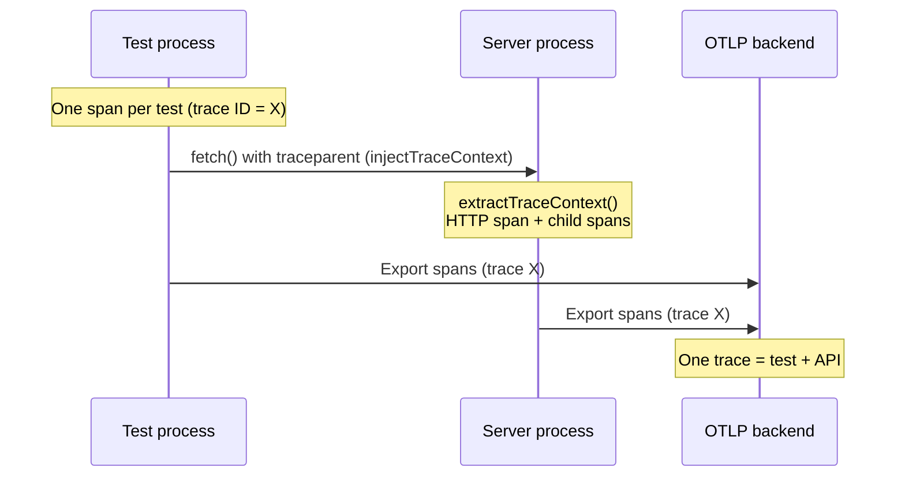

# autotel-vitest

`autotel-vitest` gives each Vitest test a parent OpenTelemetry span, so all `autotel` instrumented calls made during that test become child spans.

## How test and server appear as one trace

When you test an API over HTTP, the test runs in the **Vitest worker process** and the server runs in another process. Use `injectTraceContext()` from `autotel/http` so the request carries a `traceparent` header. Your server uses `extractTraceContext()` and creates its spans in that context, so **the same trace ID** is used on both sides. In your OTLP backend, look up the test’s trace ID to see the full trace: test span and all server spans (HTTP, handlers, `db.userId`, etc.). When you test in-process (no HTTP), all code runs in the same process and the fixture’s context automatically links test and handler spans in one trace.



## Install

Install `autotel-vitest`, `autotel`, and `vitest`:

```bash
# pnpm
pnpm add -D vitest
pnpm add autotel autotel-vitest

# npm
npm install --save-dev vitest
npm install autotel autotel-vitest

# yarn
yarn add --dev vitest
yarn add autotel autotel-vitest
```

## Quick Start

### 1. Initialize autotel in a setup file

```ts
// vitest.setup.ts
import { init } from 'autotel';
import { SimpleSpanProcessor } from 'autotel/processors';
import { otelTestCollector } from 'autotel-vitest';

init({
  service: 'unit-tests',
  spanProcessors: [new SimpleSpanProcessor(otelTestCollector)],
});
```

Two details matter here:

- **`setupFiles`, not `globalSetup`.** Spans are created in the worker that runs
  the test, and worker module state is not shared with the main process where
  `globalSetup` runs.
- **Pass `otelTestCollector` to `init`.** OpenTelemetry SDK 2.x removed
  `addSpanProcessor`, so a processor can only be registered when the provider is
  built. This is the collector the fixture drains after each test.

### 2. Register the setup file in Vitest config

```ts
// vitest.config.ts
import { defineConfig } from 'vitest/config';

export default defineConfig({
  test: {
    setupFiles: ['./vitest.setup.ts'],
  },
});
```

### 3. Import `test` from `autotel-vitest`

```ts
import { test, expect } from 'autotel-vitest';

test('creates user', async () => {
  await userService.createUser({ email: 'test@example.com' });
  expect(true).toBe(true);
});
```

The fixture is `auto: true`, so every test gets a parent span automatically.

## What You Get

- One span per test named `test:${task.name}`
- Span attributes: `test.name`, `test.file`, `test.suite`
- If a test throws, the span is marked as error and records the exception
- Any `trace()` / `span()` calls in the test flow become children of the active test span
- An `otel-trace` annotation on every test, holding the trace URL (from `OTEL_TRACE_URL_TEMPLATE`) or the raw trace id, so reporters — including the browser trace view's step list — link back to the trace
- The test's spans on `task.meta.otelSpans`, which
  [executable-stories](https://github.com/jagreehal/executable-stories) renders
  as a trace waterfall in its report with no extra wiring

## Optional: Reporter (runner-side spans)

Use the reporter when you also want runner-process spans for test/suite timing.
The reporter runs in the Vitest **main process**, so the `init()` in
`setupFiles` (which runs in workers) does not reach it. Give it its own `init()`
in a `globalSetup` file:

```ts
// globalSetup.ts (main process: tracer provider for the reporter)
import { init, shutdown } from 'autotel';

export default function setup() {
  init({ service: 'unit-tests-runner', endpoint: 'http://localhost:4318' });
  return async () => {
    await shutdown(); // flush reporter spans before the process exits
  };
}
```

```ts
// vitest.config.ts
import { defineConfig } from 'vitest/config';

export default defineConfig({
  test: {
    setupFiles: ['./vitest.setup.ts'], // workers: fixture spans
    globalSetup: './globalSetup.ts', // main process: reporter spans
    reporters: ['default', 'autotel-vitest/reporter'],
  },
});
```

Without the `globalSetup` init, the reporter's `getTracer()` gets a no-op
tracer and its spans go nowhere; the fixture's worker spans are unaffected.

Reporter spans:

- test span: `test:${name}` (attributes `test.name`, `test.fullName`, `test.file`)
- suite span: `suite:${name}` (attributes `suite.name`, `suite.file`)

Each is its own root span: reporter test spans are not children of suite spans,
and they have a different trace ID from the fixture's worker-side test span.

In browser mode, Vitest exposes a recorded Playwright trace to reporters as an
annotation attachment; the reporter copies its path onto the test span as
`test.trace.path`, so a failed span leads straight to the replay.

## Testing Utilities

`autotel-vitest` re-exports helpers from `autotel/testing`:

- `createTraceCollector`
- `assertTraceCreated`
- `assertTraceSucceeded`
- `assertTraceFailed`
- `assertNoErrors`
- `assertTraceDuration`
- `waitForTrace`
- `getTraceDuration`
- `createMockLogger`

Example:

```ts
import { test, createTraceCollector, assertTraceCreated } from 'autotel-vitest';

test('traces user creation', async () => {
  const collector = createTraceCollector();
  await userService.createUser({ email: 'test@example.com' });
  assertTraceCreated(collector, 'user.createUser');
});
```

## Troubleshooting

- No spans exported: verify `init()` runs in a `setupFiles` entry, not `globalSetup`, and that it is passed a processor wrapping `otelTestCollector`.
- No child spans under test span: ensure your test imports `test` from `autotel-vitest`, not `vitest`.
- Reporter not running: ensure `reporters` includes `'autotel-vitest/reporter'`.
- Reporter spans missing: the reporter needs `init()` in a `globalSetup` file (main process); `setupFiles` only configures workers.
- `task.meta.otelSpans` empty: a span is only in the collector after it is exported, which is asynchronous. The fixture flushes before it drains; if you read spans inside the test body, `await flush()` first.

## API

- `test`: extended Vitest `test` with auto per-test span fixture
- `otelTestCollector`: the collector the fixture drains onto `task.meta.otelSpans`; pass it to `init()` (see Quick Start)
- `expect`, `describe`, `beforeEach`, `afterEach`, `beforeAll`, `afterAll`: re-exported from `vitest`
- `autotel/testing` helpers listed above: re-exported from this package
